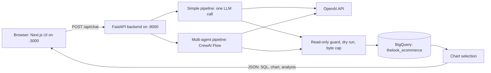
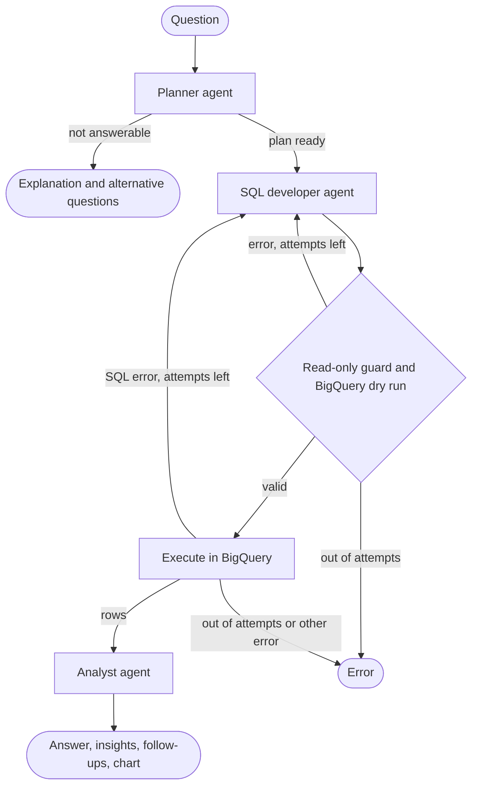

# Text-to-SQL Data Analyst

Ask questions about an e-commerce dataset in plain English and get answers as
charts and tables. An LLM writes the SQL, Google BigQuery runs it, and a
Next.js interface renders the result, with an optional multi-agent mode
(CrewAI) that also explains what the numbers mean.

> **Status:** proof of concept, built as a portfolio project. Everything below
> works locally (with or without Docker). It is not hardened for public
> deployment: there is no login or rate limiting. See
> [Security & Deployment](#-security--deployment) before exposing it to anyone.

---

## 📑 Contents

- [Overview](#-overview)
- [Features](#-features)
- [How It Works](#%EF%B8%8F-how-it-works)
- [Tech Stack](#-tech-stack)
- [Getting Started](#-getting-started)
- [Configuration Reference](#%EF%B8%8F-configuration-reference)
- [API Reference](#-api-reference)
- [Testing](#-testing)
- [Project Structure](#-project-structure)
- [Troubleshooting](#-troubleshooting)
- [Performance & Costs](#-performance--costs)
- [Security & Deployment](#-security--deployment)
- [Known Limitations](#-known-limitations)
- [Recommended for Implementation Features](#-recommended-for-implementation-features)
- [Contributing](#-contributing)
- [Development History](#-development-history)
- [License](#-license)

---

## 🔭 Overview

You type a question such as *"What were the top 5 product categories by
revenue last month?"* The app:

1. **writes** a BigQuery SQL query for it using an OpenAI model,
2. **checks** that the query is a single read-only `SELECT`,
3. **runs** it against Google's public
   [`thelook_ecommerce`](https://console.cloud.google.com/marketplace/product/bigquery-public-data/thelook-ecommerce)
   dataset (orders, order items, products, users),
4. **picks a visualization** (bar, line, pie or table) based on the shape of the
   result, and
5. **shows** the answer with the SQL it ran, ready to export.

Two interchangeable pipelines produce the answer:

| | **Simple** (default) | **Multi-agent** (CrewAI) |
|---|---|---|
| How | One LLM call writes the SQL | A planner, a SQL developer and an analyst agent, orchestrated by a CrewAI Flow |
| Extras | — | Written findings, follow-up question suggestions, polite refusals for questions the data can't answer |
| Typical time | ~3–7 s | ~13–18 s |
| LLM calls | 1 (+1 per automatic fix) | 3 (+1 per automatic fix) |

Switch between them per question with the **Multi-agent analysis** checkbox
under the chat input.

---

## ✨ Features

### Asking questions

- Type a question (up to 1,000 characters) and press **Send** or
  **Ctrl/Cmd + Enter**.
- Each answer card shows:
  - **Analysis**: what was done, how many rows came back, how long it took,
    and (in multi-agent mode) a written answer with key findings.
  - **SQL Query**: collapsible, with a copy button.
  - **Visualization**: the chart or table, with export buttons.
- A status indicator in the header shows whether the backend is ready. The
  input stays disabled until it is; while the backend starts, the app retries
  every 5 seconds and explains what is missing if the backend reports a
  configuration problem.

### Two pipelines

**Simple pipeline** (`backend/agents/simplified_pipeline.py`, the default):

1. One LLM call writes the SQL from the schema, join hints and BigQuery rules.
2. The SQL passes the read-only guard and runs in BigQuery.
3. If BigQuery rejects it, the error is sent back to the model, which fixes the
   query (up to 2 fixes).

**Multi-agent pipeline** (`backend/agents/data_crew.py`, a CrewAI Flow):

1. **Planner agent** interprets the question: which tables, filters, measures
   and chart fit. It declines questions the data can't answer (for example,
   weather) and suggests related questions it *can* answer.
2. **SQL developer agent** writes the query from the plan.
3. **Checks (code, not an agent)**: the read-only guard and a free BigQuery dry
   run validate the query before anything is executed. Any error goes back to
   the SQL developer with the exact message (up to 2 fixes).
4. **Execution (code)** runs the query.
5. **Analyst agent** reads the actual result rows and writes a direct answer,
   2–4 findings and 3 follow-up questions. Click a follow-up to put it in the
   input box.

Every agent returns structured output (Pydantic models), and agents never
delegate to each other: the Flow decides what runs next, which keeps cost and
latency bounded. Your pipeline choice is remembered in the browser. The server
default is set with `PIPELINE_MODE`.

### Automatic visualization

The chart type is chosen from the shape of the result:

| Result shape | Visualization |
|---|---|
| A date column + a numeric column (≤ 100 rows) | Line chart |
| A text column + a numeric column (≤ 30 rows) | Bar chart; horizontal when there are more than 6 bars or long labels, so every label stays readable |
| Two numeric columns (e.g. year + revenue) | Line chart |
| Anything else (one value, 4+ columns, many rows) | Table (first 100 rows shown) |

In multi-agent mode the planner can refine this: **pie** for "share of" questions
(up to 8 non-negative slices) or **table** for detailed listings. Charts have
hover tooltips and formatted numbers. Tables right-align numbers and show
missing values as "—".

### Safety and cost controls

- **Read-only guard**: generated SQL must be a single `SELECT`/`WITH` statement.
  `INSERT`, `DELETE`, `DROP`, scripts and multiple statements are rejected before
  reaching BigQuery (string literals and comments are ignored when checking).
- **Byte cap**: every query has a BigQuery `maximum_bytes_billed` limit
  (`BQ_MAX_BYTES_BILLED`, 10 GB by default); larger queries fail instead of
  running.
- **Row cap**: at most `BQ_MAX_RESULTS_ROWS` rows (1,000) are downloaded per
  query; the UI says when a result was truncated.
- **Timeouts**: BigQuery 30 s, LLM calls 30–60 s, the multi-agent flow 110 s,
  the browser 120 s.
- **Clean error messages**: errors shown in the UI and sent to the LLM are
  scrubbed of your GCP project ID, service account emails, API keys and
  request URLs. Full errors stay in the server log.
- **Least privilege**: the service account only needs permission to run
  queries (see [Getting Started](#2-set-up-google-cloud)).

### Workspace

All of this is stored in your browser (`localStorage`); nothing is saved on
the server.

- **Conversation**: the last 100 messages survive page reloads. Download the
  conversation as JSON, or clear it (the clear is permanent).
- **Export**: download any result as **CSV** or **JSON**, or copy it to the
  clipboard as JSON. Copy the SQL from its panel.
- **History panel** (clock icon): every question you send is recorded
  automatically (the last 20, plus favorites). Search it, copy a question, star
  it, or click it to put it back in the input box.
- **Favorites panel** (star icon): star an answer to save its question, add
  tags to it, then search favorites or filter them by tag (up to 50).
- **Analytics panel** (chart icon): total and unique questions, success rate,
  average response time, questions per day over the last week, and which SQL
  features (JOIN, WHERE, GROUP BY, ORDER BY, CTEs) the generated queries used.
- **Query Builder** (sliders icon, *in testing*): write a base question, add
  typed parameters (text, number, date, true/false) or quick templates (limit,
  offset, start/end date, include metrics), preview the result, and apply it.
  It produces a plain-language question such as
  *"Top 10 brands by revenue (limit: 10, start date: 2024-01-01)"*.
- **Dark mode**: follows your system setting until you toggle it in the header;
  the choice is remembered.
- **Copy feedback**: copy buttons in History and Favorites confirm with a short
  "Copied!" animation (or "Failed" if the browser blocks clipboard access).

**Keyboard shortcuts**

| Shortcut | Action |
|---|---|
| Ctrl/Cmd + Enter | Send the question |
| Ctrl/Cmd + K | Focus the question input |
| Escape | Close the open sidebar panel |

### Error messages

Errors are grouped into types, each with a plain-language explanation,
suggestions, and collapsible technical details: SQL errors (with specific hints
for unknown columns and unsupported date functions), unavailable OpenAI model,
OpenAI authentication, rate limits, Google Cloud authentication, and connection
problems.

---

## 🏗️ How It Works

### Architecture



The browser talks to the backend directly, so the backend must be reachable at
the URL baked into the frontend (`NEXT_PUBLIC_API_URL`, `http://localhost:8000`
by default). Both pipelines share one module, `backend/agents/common.py`,
containing the SQL rules given to the model, the read-only guard, SQL
extraction and chart selection, so their safety rules can't drift apart.

### Multi-agent flow



Why the original crew was rebuilt this way is documented in
[`dev_docs/CREWAI_PIPELINE_REVIEW.md`](dev_docs/CREWAI_PIPELINE_REVIEW.md).

### Dataset

Queries run against `bigquery-public-data.thelook_ecommerce`, a synthetic
e-commerce dataset maintained by Google:

| Table | Rows (approx.) | Contents |
|---|---|---|
| `orders` | 125k | One row per order: status, timestamps, item count, customer gender |
| `order_items` | 182k | One row per item sold: product, sale price, status, timestamps |
| `products` | 29k | Category, brand, department, cost, retail price |
| `users` | 100k | Demographics, location, acquisition channel |

Status values are `Processing`, `Shipped`, `Complete`, `Returned` and
`Cancelled`. The dataset is regenerated continuously and contains some rows
dated slightly in the future, which the SQL rules account for. The column list
given to the model lives in `backend/schemas/bigquery_schema.py` and was
verified against the live tables.

---

## 🧰 Tech Stack

| Layer | Technology |
|---|---|
| Frontend | Next.js 16 (App Router, Turbopack), React 19, TypeScript 5, Tailwind CSS 4, Recharts 3, Zustand 5, Axios, Lucide icons |
| Backend | Python 3.11–3.13, FastAPI, Uvicorn, Pydantic 2 / pydantic-settings |
| AI | OpenAI (`gpt-4o-mini` by default) via LangChain (simple pipeline) and CrewAI 1.15 Flows (multi-agent pipeline) |
| Data | Google BigQuery (`google-cloud-bigquery`) |
| Tooling | Docker & Docker Compose, pytest, ESLint |

Backend versions are pinned in `backend/requirements.txt`; frontend versions in
`frontend/package-lock.json`.

---

## 🚀 Getting Started

### Prerequisites

**Accounts**

- A **Google Cloud** project with the BigQuery API enabled. Querying this
  dataset fits comfortably in BigQuery's free tier (the first 1 TiB of query
  processing per month is free).
- An **OpenAI** API key with access to the model you configure
  (`gpt-4o-mini` by default) and some credit on the account.

**Software**

- **Option A (recommended): Docker Desktop** (or Docker Engine with Compose v2)
  and Git.
- **Option B (no Docker):** Python 3.11–3.13, Node.js 20.9+ (24 recommended)
  and Git.

### 1. Clone the repository

```bash
git clone https://github.com/lnitc/text-to-sql.git
cd text-to-sql
```

### 2. Set up Google Cloud

The app needs a service account that may **run BigQuery queries** in your
project. The public dataset is readable by any authenticated Google account,
so the BigQuery Job User role is enough; add BigQuery Data Viewer only if you
point the app at your own datasets.

**With the `gcloud` CLI** (replace `YOUR_PROJECT_ID`):

```bash
gcloud config set project YOUR_PROJECT_ID
gcloud services enable bigquery.googleapis.com

gcloud iam service-accounts create text-to-sql-sa --display-name="Text-to-SQL app"
gcloud projects add-iam-policy-binding YOUR_PROJECT_ID \
  --member="serviceAccount:text-to-sql-sa@YOUR_PROJECT_ID.iam.gserviceaccount.com" \
  --role="roles/bigquery.jobUser"

# Creates gcp-key.json in the current directory (the project root)
gcloud iam service-accounts keys create gcp-key.json \
  --iam-account=text-to-sql-sa@YOUR_PROJECT_ID.iam.gserviceaccount.com
```

**Or in the Cloud Console:** IAM & Admin → Service Accounts → *Create service
account* → grant **BigQuery Job User** → open the account → *Keys* → *Add key*
→ JSON. Save the file as `gcp-key.json` in the project root.

`gcp-key.json` is gitignored. Never commit it.

> **Key creation blocked?** Some organizations disable service account keys
> (`iam.disableServiceAccountKeyCreation`). For running the backend locally
> without Docker you can use your own Google credentials instead: run
> `gcloud auth application-default login`, leave `GOOGLE_APPLICATION_CREDENTIALS`
> empty in `.env`, and don't create `gcp-key.json`. The Docker setup expects a
> key file.

### 3. Get an OpenAI API key

Create a key at <https://platform.openai.com/api-keys>. While you're there, set a
monthly budget and usage limits for the project under billing settings; the app
itself doesn't track spending.

### 4. Configure environment variables

```bash
cp .env.example .env
```

Edit `.env` and fill in at least:

| Variable | Value |
|---|---|
| `OPENAI_API_KEY` | Your OpenAI key (`sk-...`) |
| `GCP_PROJECT_ID` | Your Google Cloud project ID (queries are billed to it) |
| `GOOGLE_APPLICATION_CREDENTIALS` | `gcp-key.json` (relative to the project root). Docker Compose overrides this with the mounted path. |

Everything else has working defaults; see the
[Configuration Reference](#%EF%B8%8F-configuration-reference). `.env` is gitignored.

### 5a. Run with Docker (recommended)

```bash
docker compose up -d --build
```

The first build takes several minutes (it installs CrewAI and builds the
frontend). Then:

- App: <http://localhost:3000>
- API docs (Swagger): <http://localhost:8000/docs>

Useful commands:

```bash
docker compose ps                 # status and health
docker compose logs -f backend    # backend logs
docker compose down               # stop
docker compose up -d --build      # rebuild after code or NEXT_PUBLIC_* changes
```

Both ports are published on `127.0.0.1` only, so other devices on your network
can't reach the app.

### 5b. Run locally without Docker

**Backend** (in one terminal):

```bash
cd backend
python -m venv venv                  # keep the virtualenv inside backend/
source venv/bin/activate             # Windows: venv\Scripts\activate
pip install -r requirements-dev.txt  # runtime deps + pytest
python -m uvicorn main:app --reload  # http://localhost:8000
```

The backend reads the root `.env` automatically. If the configured
credentials path doesn't exist (for example the Docker path
`/secrets/gcp-key.json`), it falls back to `gcp-key.json` in the project root.

**Frontend** (in a second terminal):

```bash
cd frontend
npm install
npm run dev                          # http://localhost:3000
```

The frontend calls `http://localhost:8000` by default. To use another backend
URL, create `frontend/.env.local` with `NEXT_PUBLIC_API_URL=...`. In VS Code,
select `backend/venv` as the Python interpreter rather than creating another
environment at the project root.

### 6. Verify

```bash
curl http://localhost:8000/health
# {"status":"ok","message":"Settings validated successfully","version":"1.0.0","default_pipeline":"simple"}
```

Then open <http://localhost:3000>. The header should say **Backend Ready**. Try:

- *How many orders were placed in the last 7 days?* (single number → table)
- *What were the top 5 product categories by revenue last month?* (bar chart)
- *Show monthly revenue for 2024* (line chart)
- *Which traffic sources bring the most users?* (bar chart)
- With **Multi-agent analysis** on: *What share of users comes from each traffic
  source?* (written findings, follow-ups, possibly a pie chart)

If `status` is `degraded`, its `message` says what is missing.

---

## ⚙️ Configuration Reference

Settings come from environment variables first, then from `.env` /
`.env.local` in the project root or `backend/`. Unknown variables are ignored.
With Docker, only the variables listed under `backend.environment` in
`docker-compose.yml` reach the container.

| Variable | Default | Description |
|---|---|---|
| `OPENAI_API_KEY` | *(required)* | OpenAI API key |
| `OPENAI_MODEL` | `gpt-4o-mini` | Model for all LLM calls (e.g. `gpt-4o` for higher quality) |
| `OPENAI_MAX_TOKENS` | `2000` | Max tokens per LLM response |
| `GCP_PROJECT_ID` | *(required)* | Project that runs (and pays for) the queries |
| `GOOGLE_APPLICATION_CREDENTIALS` | *(empty)* | Service account key path, relative to the project root or absolute. Empty means Application Default Credentials |
| `PIPELINE_MODE` | `simple` | Default pipeline: `simple` or `crew`. The UI toggle overrides it per question |
| `BQ_QUERY_TIMEOUT_SECONDS` | `30` | BigQuery execution timeout |
| `BQ_MAX_RESULTS_ROWS` | `1000` | Max rows downloaded per query |
| `BQ_MAX_BYTES_BILLED` | `10737418240` (10 GB) | Per-query scan limit; larger queries fail |
| `CORS_ORIGINS` | `["http://localhost:3000", "http://127.0.0.1:3000", "http://frontend:3000"]` | Allowed browser origins, as a JSON list |
| `NEXT_PUBLIC_API_URL` | `http://localhost:8000` | Backend URL **as seen from the browser**; built into the frontend, so rebuild after changing it |
| `ENVIRONMENT` | `development` | `development`, `staging` or `production` (informational) |
| `DEBUG` | `false` | Shows exception details in 500 responses and verbose CrewAI output |
| `LOG_LEVEL` | `INFO` | Log level when started with `python main.py` |
| `ENABLE_REQUEST_LOGGING` | `true` | Log each HTTP request with its duration |
| `BACKEND_PORT` | `8000` | Port for `python main.py` and the API docs' server URL (Docker always uses 8000) |
| `CREWAI_DISABLE_TELEMETRY` | `true` | CrewAI's anonymous telemetry is off unless you set this to `false` |

To query **your own data**, describe your tables in
`backend/schemas/bigquery_schema.py` (project, dataset, table and fields, and
register them in `SCHEMAS`), update the join hints (`RELATIONSHIPS`) and any
dataset-specific rules (`SQL_RULES`) in `backend/agents/common.py`, and grant the
service account BigQuery Data Viewer on that dataset.

---

## 🔌 API Reference

Interactive documentation is served at <http://localhost:8000/docs>.

| Method & path | Purpose |
|---|---|
| `GET /health` | Service status: `ok` or `degraded` with a reason, plus the default pipeline |
| `POST /api/chat` | Answer a question |
| `GET /` | API information |

**`POST /api/chat`**

```json
{ "user_query": "Revenue by department this year", "pipeline": "crew" }
```

`pipeline` is optional (`simple` or `crew`; defaults to `PIPELINE_MODE`).
Response (values illustrative):

```json
{
  "thought_process": "Women's products brought in $1.2M this year, ...",
  "sql_query": "SELECT p.department, SUM(oi.sale_price) AS total_revenue FROM ...",
  "chart": {
    "chart_type": "bar",
    "data": [{ "department": "Women", "total_revenue": 1203456.7 }, { "department": "Men", "total_revenue": 1110022.1 }],
    "x_axis_key": "department",
    "y_axis_key": "total_revenue",
    "title": "total_revenue by department"
  },
  "execution_time_ms": 14210.5,
  "pipeline": "crew",
  "insights": ["Women's products lead by about 8%."],
  "follow_up_questions": ["How does this compare to last year?"]
}
```

`insights` and `follow_up_questions` are empty for the simple pipeline. Errors
use one format for every status code (400, 404, 422, 500, 503):

```json
{ "error": "ValidationError", "message": "user_query: String should have at most 1000 characters", "status_code": 422, "details": null }
```

---

## 🧪 Testing

**Backend** (76 tests, a few seconds):

```bash
cd backend
pip install -r requirements-dev.txt
pytest
```

The suite covers the read-only SQL guard, SQL extraction, chart selection,
BigQuery value conversion and error sanitizing, every API endpoint (including
that errors never leak the project ID or keys), and the multi-agent flow's
routing: planning, dry-run and execution retries, refusals, and that write
queries never execute. OpenAI and BigQuery are replaced by fakes, so the tests
need no credentials, make no network calls and cost nothing.

**Frontend** (no automated tests yet; these checks catch type, lint and build
errors):

```bash
cd frontend
npx tsc --noEmit
npm run lint
npm run build
```

**Manual smoke test** after changes:

1. `/health` returns `ok` and the header shows **Backend Ready**.
2. The example questions from [Verify](#6-verify) produce a table, bar chart
   and line chart.
3. With **Multi-agent analysis** on, an answer shows insights and clickable
   follow-ups; *"What will the weather be tomorrow?"* is declined politely.
4. Export CSV/JSON, copy SQL, star a question, find it in Favorites and
   History, and check the Analytics panel.
5. Toggle dark mode and reload: the theme and conversation persist.

---

## 📁 Project Structure

```
text-to-sql/
├── frontend/                          # Next.js 16 frontend
│   ├── app/
│   │   ├── page.tsx                   # Main page
│   │   ├── layout.tsx                 # Root layout
│   │   ├── ChatInterface.tsx          # Chat UI, sidebar panels, pipeline toggle
│   │   ├── ChatMessage.tsx            # One answer: analysis, insights, SQL, chart
│   │   ├── ChartRenderer.tsx          # Bar/line/pie/table rendering (Recharts)
│   │   ├── api.ts                     # API client (Axios)
│   │   ├── store.ts                   # Zustand store (messages, saved queries)
│   │   ├── globals.css                # Tailwind CSS, dark-mode variant, animations
│   │   ├── components/                # Favorites, History, Analytics, Query Builder, CopyButton
│   │   ├── hooks/                     # Dark mode, saved queries, persistence, shortcuts
│   │   └── utils/                     # Error parsing, CSV/JSON export
│   ├── public/                        # Static assets
│   ├── next.config.ts                 # Next.js configuration
│   ├── AGENTS.md                      # Notes for AI coding agents on Next.js 16
│   ├── package.json                   # Dependencies
│   ├── Dockerfile                     # Multi-stage build (standalone server)
│   └── .dockerignore
│
├── backend/                           # FastAPI backend
│   ├── main.py                        # FastAPI app, endpoints, error handling
│   ├── config.py                      # Settings & validation
│   ├── run.py                         # Uvicorn startup wrapper (Docker)
│   ├── agents/
│   │   ├── common.py                  # SQL rules, read-only guard, chart selection
│   │   ├── simplified_pipeline.py     # Default pipeline (one LLM call)
│   │   └── data_crew.py               # CrewAI multi-agent Flow
│   ├── tools/
│   │   └── bigquery_tool.py           # Query execution, dry runs, safe error messages
│   ├── schemas/
│   │   ├── bigquery_schema.py         # Table definitions given to the LLM
│   │   └── models.py                  # Pydantic request/response models
│   ├── tests/                         # pytest suite (no network or credentials needed)
│   ├── requirements.txt               # Runtime dependencies (pinned)
│   ├── requirements-dev.txt           # Runtime + test & formatting tools
│   ├── pytest.ini
│   ├── Dockerfile
│   └── .dockerignore
│
├── dev_docs/
│   ├── development_story.md           # How the app was built, stage by stage
│   └── CREWAI_PIPELINE_REVIEW.md      # Why the first multi-agent pipeline was rebuilt
├── docker-compose.yml                 # Docker Compose orchestration
├── .env.example                       # Environment template (copy to .env)
├── .env                               # Your settings (gitignored, never commit)
├── gcp-key.json                       # Service account key (gitignored, never commit)
└── README.md
```

---

## 🐛 Troubleshooting

**Header shows "Backend Error" / "Backend is not responding"**
- Check the backend is up: `docker compose ps` or `curl http://localhost:8000/health`.
  The backend takes a few seconds to start; the page retries every 5 seconds.
- If you serve the frontend from a different address or port, add that origin
  to `CORS_ORIGINS`.
- If you changed `NEXT_PUBLIC_API_URL`, rebuild the frontend
  (`docker compose up -d --build`): the value is fixed at build time. It must be
  a URL the **browser** can reach (`http://localhost:8000`, not
  `http://backend:8000`).

**"Backend is running but not ready" / `/health` says `degraded`**
- The message names the problem, e.g. `OPENAI_API_KEY is not set` or
  `GCP credentials file not found`. Fix `.env` and restart the backend
  (`docker compose up -d` recreates containers with the new values).
- With Docker, `gcp-key.json` must exist in the project root before starting.
  Otherwise Docker fails with a `mkdir` error or creates an empty *directory*
  with that name; delete any such directory and add the real file.

**Questions fail with "OpenAI Authentication Error" or "Model Unavailable"**
- Check the key and that it has credit; check `OPENAI_MODEL` is a model your
  account can use.

**Questions fail with "Access Denied" from BigQuery**
- The service account needs BigQuery Job User on `GCP_PROJECT_ID`, and the
  BigQuery API must be enabled in that project.

**A question keeps producing SQL errors**
- Both pipelines already retry with the error. Rephrase with explicit names
  (*"revenue by product category"*), or try **Multi-agent analysis**, whose
  planner handles vague questions better.

**The first multi-agent answer is slow**
- Loading CrewAI adds about 9 seconds to the first multi-agent request after a
  backend start. Set `PIPELINE_MODE=crew` to load it at startup instead.

**Port 3000 or 8000 is already in use**
- Stop the other process, or change the host side of the port mapping in
  `docker-compose.yml` (and `NEXT_PUBLIC_API_URL` / `CORS_ORIGINS` to match).

---

## 📊 Performance & Costs

**Response times** (measured locally with `gpt-4o-mini`):

| Pipeline | Typical | Notes |
|---|---|---|
| Simple | 3–7 s | One LLM call plus the BigQuery query |
| Multi-agent | 13–18 s | Three agent steps of about 4–7 s each |
| Multi-agent, refusal | ~4 s | Only the planner runs |

**Costs per question** (approximate, at the time of writing; check current
[OpenAI](https://openai.com/api/pricing/) and
[BigQuery](https://cloud.google.com/bigquery/pricing) pricing):

- **OpenAI (`gpt-4o-mini`)**: about $0.0005 for the simple pipeline and a few
  tenths of a cent for the multi-agent pipeline, which sends the schema to
  three agents. Larger models cost proportionally more.
- **BigQuery**: queries on this dataset scan a few MB to tens of MB, so normal
  use stays within the free 1 TiB per month. `BQ_MAX_BYTES_BILLED` caps any
  single query.

---

## 🔐 Security & Deployment

### Credentials
- Keep secrets in `.env` and `gcp-key.json`; both are gitignored. Never commit them.
- Give the service account only the roles it needs (BigQuery Job User; Data
  Viewer only for your own datasets), and rotate keys periodically.

### Built-in protections
- Request validation with Pydantic (question length 1–1,000 characters).
- Generated SQL must be a single read-only `SELECT`/`WITH` query, is checked
  with a BigQuery dry run in multi-agent mode, and is capped at
  `BQ_MAX_BYTES_BILLED` bytes per query.
- Error messages are scrubbed of the GCP project ID, service account emails,
  API keys and request URLs before they reach the browser.
- CORS restricted to the configured origins (`CORS_ORIGINS`).
- Docker Compose publishes ports on `127.0.0.1` only. The frontend container
  runs as an unprivileged user.
- The browser stores only conversation history, saved questions and
  preferences; no credentials.
- **There is no authentication and no rate limiting.** See below.

### Deploying beyond your own machine

Every question costs money (OpenAI tokens plus BigQuery scans), and the API has
**no login and no rate limiting**. That is fine on your own computer. Before
making the app reachable by anyone else:

1. **Require sign-in at the platform level.** For people using a browser,
   put both services behind an authenticating proxy such as Google Cloud
   Identity-Aware Proxy (IAP), and grant access only to the accounts that
   should use the app. Protect the backend as well as the frontend: the
   browser calls the backend directly (`NEXT_PUBLIC_API_URL`), so an open
   backend URL can be used without ever loading the UI. (Cloud Run's
   `--no-allow-unauthenticated` on its own suits service-to-service calls;
   browsers don't attach the identity token it requires.)
2. **Add rate limiting** if anyone besides you can reach the API: per-user or
   per-IP limits in the app (e.g. [slowapi](https://github.com/laurentS/slowapi)
   on `/api/chat`) or at the edge (API Gateway, Cloud Armor rate-based rules).
3. **Cap spending at the source**: set a budget and usage limits on your OpenAI
   project, set BigQuery custom quotas (query usage per day), and keep
   `BQ_MAX_BYTES_BILLED` low.
4. **Point the app at its real URLs**: set `CORS_ORIGINS` to the frontend's
   origin as a JSON list (e.g. `CORS_ORIGINS='["https://app.example.com"]'`),
   rebuild the frontend with `NEXT_PUBLIC_API_URL` set to the backend's URL,
   and serve both over HTTPS.
5. **Use a least-privilege service account**, and never bake `gcp-key.json`
   into an image; on GCP, attach the service account to the service instead of
   using a key file.

---

## 🚧 Known Limitations

- **No conversation memory**: each question is answered independently, so
  *"and last year?"* doesn't know what *"this year"* referred to. Clicking a
  multi-agent follow-up suggestion works because those are full questions.
- **One dataset, fixed schema**: the table list is hardcoded for
  `thelook_ecommerce` (switching datasets means editing two files; see the
  [Configuration Reference](#%EF%B8%8F-configuration-reference)).
- **LLM accuracy**: the model can misread ambiguous questions or pick a
  questionable definition (for example, which order statuses count as revenue).
  Always check the SQL panel.
- **Pie charts only in multi-agent mode** (chosen by the planner).
- **Query Builder is basic**: it turns free-form parameters into text appended
  to the question; it doesn't know the schema.
- **Browser-only storage**: history, favorites and the conversation live in one
  browser's `localStorage` and don't sync across devices.
- **No authentication or rate limiting** (see
  [Security & Deployment](#-security--deployment)).
- **No automated frontend tests.**
- **Backend Docker image uses Python 3.11**, which reaches end of life in
  October 2027 (the code is tested on 3.13 locally).

---

## 💡 Recommended for Implementation Features

Ideas that would add the most value, roughly in priority order. None are
implemented yet.

1. **Authentication and rate limiting**: required before any shared deployment
   (see [Deploying beyond your own machine](#deploying-beyond-your-own-machine)).
2. **Accuracy evaluation set**: a fixed list of questions with known correct
   answers, run against both pipelines to measure SQL accuracy whenever the
   prompt, rules or model change. The most useful safeguard for a text-to-SQL
   app.
3. **Conversation context**: pass recent questions and SQL to the model so
   follow-ups like *"and by month?"* work.
4. **Streaming progress for the multi-agent pipeline**: show *planning → writing
   SQL → analyzing* as it happens instead of one 15-second wait.
5. **Cost preview**: use the dry run to show how much data a query will scan
   before running it, and ask for confirmation above a threshold.
6. **Result caching**: return cached answers for repeated questions (with a
   time limit) to save time and money.
7. **Dynamic schema discovery**: read table definitions from BigQuery's
   `INFORMATION_SCHEMA` instead of a hardcoded file, enabling other datasets
   without code changes.
8. **Interactive charts**: let users switch chart type or axes, and export a
   chart as an image.
9. **Smarter Query Builder**: schema-aware filters (pick a table, column and
   value) instead of free-text key/value pairs.
10. **Frontend tests and CI**: component tests (Vitest + React Testing
    Library), an end-to-end test (Playwright), and a GitHub Actions workflow
    running pytest, lint, type check and both Docker builds on every push.
11. **Usage and cost tracking**: record tokens and bytes per request and show
    them in the Analytics panel.
12. **Python 3.13 backend image** before Python 3.11's end of life.
13. **Responsive layout**: collapse the sidebar on small screens.

---

## 🤝 Contributing

Contributions and forks are welcome. A few conventions keep things working:

- Run `pytest` in `backend/` and `npx tsc --noEmit && npm run lint` in
  `frontend/` before committing; add tests for new backend behavior.
- Keep SQL rules, the read-only guard and chart selection in
  `backend/agents/common.py` so both pipelines stay consistent.
- Change the model's view of the data in `backend/schemas/bigquery_schema.py`,
  and verify column names against the real tables.
- Remember that `NEXT_PUBLIC_*` values are fixed at build time.
- Tailwind CSS 4's `dark:` variant is tied to the app's theme toggle (the
  `.dark` class) in `frontend/app/globals.css`, not to the operating system.
- Next.js 16 differs from older versions; `frontend/AGENTS.md` points AI coding
  agents (and humans) to the bundled docs.
- Never commit `.env`, `.env.local` or `gcp-key.json`.

---

## 📜 Development History

[`dev_docs/development_story.md`](dev_docs/development_story.md) tells how the
app was built, from the original plan through each phase, the bugs found along
the way, and the lessons learned.

---

## 📝 License

This project has no formal license. Anyone is welcome to reuse, modify and
share the code **at their own risk**: it is provided as is, without warranty of
any kind, and the author is not responsible for any damage or costs (including
cloud and API charges) resulting from its use.
